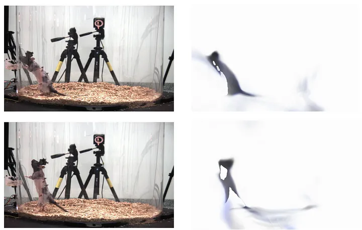
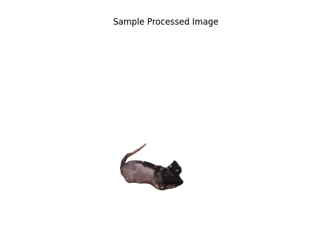
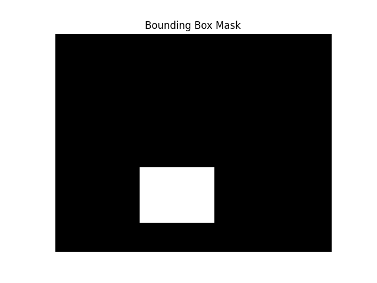
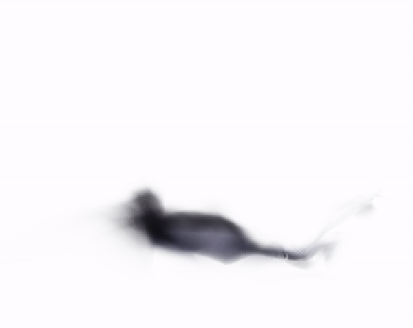

# RatNeRF


# 4D Dynamic NeRF without SFM

A novel NeRF-based framework designed to model non-human articulated objects (e.g., rats) using 3D keypoints and their parent-child relationships — without relying on skeleton models, multi-view cameras, or predefined surface meshes.

---

## 🧠 Key Features

- **Monocular Video Input**: Works with a single static camera.
- **Keypoint-Relative Encoding**: Encodes query points using relative distance, direction, and ray direction from 3D keypoints.
- **No Skeletons Required**: Avoids reliance on SMPL or similar models, ideal for non-human subjects.
- **SAM2 Integration**: Uses segmentation preprocessing to isolate articulated objects (e.g., rats).
- **Validates on Rat7M**: Demonstrates generalizability and effectiveness on complex motion data.

---



## 📦 Methodology

### 1. Preprocessing
- Segment videos using **SAM2**.
- Replace background with white.
- Compute bounding boxes for efficient ray sampling.

### 2. Keypoint Extraction
- Use 3D mocap keypoints from DANCCE (Rat7M).
- Structure them in parent-child hierarchies.
- Compute transformation matrices per frame and per keypoint.

### 3. Encoding Pipeline
For each sampled query point and ray:
- Compute:
  - Reference pose encoding
  - Keypoint-relative position
  - Relative distance
  - Relative direction
  - Relative ray direction
- Apply positional embedding.
- Feed into MLP to predict density and color.

### 4. Volumetric Rendering
- Standard NeRF-style ray marching for final pixel synthesis.

---


## 🛠️ Installation & Usage

1. Clone the repo:
   ```bash
   git clone https://github.com/bargav25/RatNeRF.git
   cd RatNeRF
   ```
2. Set up environment:
   ```bash
   conda create -n anerf python=3.8
   conda activate anerf

   # install pytorch for your corresponding CUDA environments
   pip install torch

   # install pytorch3d: note that doing `pip install pytorch3d` directly may install an older version with bugs.
   # be sure that you specify the version that matches your CUDA environment. See: https://github.com/facebookresearch/pytorch3d
   pip install pytorch3d -f https://dl.fbaipublicfiles.com/pytorch3d/packaging/wheels/py38_cu102_pyt190/download.html

   # install other dependencies
   pip install -r requirements.txt
   ```
3. Prepare input data:
   - Dataset used: DANNCE (https://pmc.ncbi.nlm.nih.gov/articles/PMC8530226/)
   - For better results, run through SAM v2 to get the remove the noisy background.




4. Run the demo:
   ```bash
   python run_nerf.py --config configs/rat.txt
   ```
---

Training takes couple of hours on V100 

## Sample Video Output



